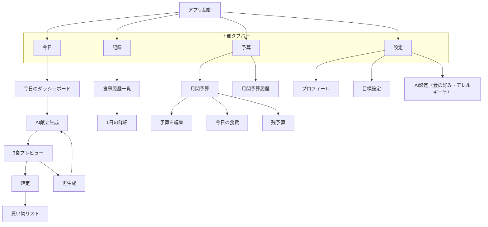

# 概要

## **① ターゲット**

- ダイエットしたい
- でも自分で食事を考えるのがめんどくさい
- 食費も気にしている
- アプリが続かない20〜40代

＝ **「意思はあるけど判断がしんどい人」**

---

## **② 何の問題を**

- 何を食べればいいかわからない
- 栄養バランスを自分で考えられない
- 食費がどれくらいかかるか分からない
- だから結局適当に食べて太る or 破産

---

## **③ どうやって解決するか**

AIが

> 「あなたは今日はこれを食べてください」

と

**予算と栄養を同時に満たす献立を自動生成**。

- 朝昼夜
- カロリー
- PFC
- 想定金額
- 買い物リスト

まで全部出す。

ユーザーは

**考えずに買って食べるだけ**。

---

## **④ 代替手段との違い**

| **既存アプリ** | **このアプリ** |
| -------------- | -------------- |
| 食後に入力     | **食前に指示** |
| カロリーだけ   | **栄養＋お金** |
| 自分で考える   | **AIが決める** |
| 続かない       | **思考ゼロ**   |

---

## **⑤ マネタイズ**

- 月額 980〜1980円
- 無料トライアル7日

# **MVP機能リスト**

> 目標：

> 「今日、何をどれくらいの金額で食べればいいか」が5秒で分かる

---

## **① ユーザー登録・プロフィール**

最低限これだけ：

- 性別
- 年齢
- 身長
- 体重
- 目標体重
- 活動量（低・中・高）
- 月の食費
- 嫌いな食べ物（任意）

---

## **② 今日の献立生成（AI）**

ボタン1つで：

- 朝 / 昼 / 夜
- 料理名
- 想定カロリー
- PFC（タンパク質・脂質・炭水化物）
- 想定コスト

---

## **③ 買い物リスト生成**

- 今日 or 3日分
- 食材名
- 量

スーパーでこのまま買えるレベル。

---

## **④ 予算トラッキング**

- 今月の予算
- 月の残り食費
- 今日の献立の予想消費額
- 予算編集

---

## **⑤ 履歴**

- 過去の献立
- 使った金額
- カロリー

（グラフなし、一覧だけ）

---

## **⑥ 設定変更**

- プロフィール編集

# 画面

